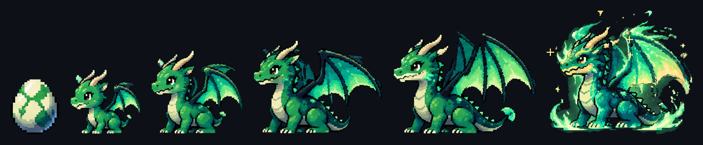
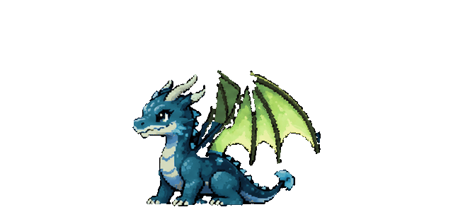

# git-dragon

An emerald pixel-art dragon for your GitHub profile `README.md`. It hatches from an egg, grows with your contribution count, takes on the colours of the languages you write, and loops as a small animated GIF: flapping wings, blinking eyes, and (once it is old enough) breathing fire.

**Try it live:** [codewithsyedabdullah.github.io/git-dragon](https://codewithsyedabdullah.github.io/git-dragon/) — type any GitHub username and your dragon hatches right in the browser (same renderer, the real sprite art, no install).



## How it works

1. **Collect** your public GitHub activity: contribution total, streaks, and the primary language of each repository (GraphQL with a token, REST fallback without).
2. **Choose a stage** from the contribution count.
3. **Tint** the dragon from your top three languages, using the colour GitHub reports for each language.
4. **Animate** a seamless 48-frame loop and write `dragon.gif`, `dragon.png`, `share-card.png` and `preview.html`.

The art is hand-finished pixel-art layers (body and wing, per stage) compiled into the binary. Everything that moves or changes colour is done in code: wing swing, eyelids, fire, embers, stars and language tinting. Output is deterministic: the same snapshot always yields byte-identical files.

## Evolution stages

| Contributions | Stage | What changes |
|---|---|---|
| 0 | **Dragon Egg** | Green-and-cream shell that catches a slow glint. |
| 1 - 149 | **Baby Dragon** | Big head, tiny horns and wings, flutters its wings and blinks. |
| 150 - 499 | **Young Dragon** | Longer body, wider wings, longer horns, back spikes. |
| 500 - 1,199 | **Adolescent Dragon** | Large veined wings, stronger legs, **small fire breath**. |
| 1,200 - 2,499 | **Adult Dragon** | Full size, broad wings, long tail with a crest tip, bigger fire breath. |
| 2,500+ | **Legendary Dragon** | Glowing emerald aura, rising embers, twinkling stars, golden wing edges, big fire breath. |

It is the same character at every stage: face, colours and pixel style stay consistent. Wing swing grows with the stage.

By default the count is for the current calendar year (it resets to an egg on January 1st). Use `--window rolling` for the trailing 365 days.

## Language colours

The dragon's default look is emerald, turquoise and cream. When language data is available:

| Zone | Comes from | Parts |
|---|---|---|
| Primary | most-used language | scales, belly, highlights |
| Secondary | second language | wing membranes |
| Tertiary | third language | horns and crest |

How strongly a zone is tinted depends on that language's share, so a one-language profile is tinted strongly and a mixed profile keeps more of the original emerald art. Colours are the ones GitHub returns (Linguist); an offline Linguist table covers the REST fallback. Very dark language colours are lightened so the outline stays readable. With no usable language data, or with `--canon`, you get the untouched emerald dragon.



## Use it on your profile

Create `.github/workflows/dragon.yml` in your `<username>/<username>` repository:

```yaml
name: Update Profile Dragon

on:
  schedule:
    - cron: "15 0 * * *"
  workflow_dispatch:

permissions:
  contents: write

jobs:
  update-dragon:
    runs-on: ubuntu-latest
    steps:
      - uses: actions/checkout@v4
      - uses: codewithsyedabdullah/git-dragon@v1
        with:
          window: annual
          branch: output
```

The action is referenced as `@v1`, so publish that tag first in this repository (`git tag v1 && git push origin v1`, or create a release named `v1`).

Then add this to your profile `README.md`:

```markdown

```

### Action inputs

| Input | Default | Description |
|-------|---------|-------------|
| `login` | repository owner | GitHub account to draw. |
| `window` | `annual` | `annual` (resets Jan 1) or `rolling` (trailing 365 days). |
| `canon` | `"false"` | `"true"` ignores language colours. |
| `output-dir` | `dragon` | Folder for the generated files. |
| `commit` | `"true"` | `"false"` leaves the files in the workspace. |
| `branch` | `output` | Branch the files are published to. |
| `token` | `github.token` | Token used to read data and push. |

## Run it locally

Requires Rust 1.78 or newer.

```bash
cargo build --release

# Everything in one step (set GITHUB_TOKEN for private-contribution counts and GraphQL data)
./target/release/git-dragon generate YOUR_USERNAME --output-dir dragon

# Or in two steps
./target/release/git-dragon collect YOUR_USERNAME --output snapshot.json
./target/release/git-dragon render snapshot.json --output-dir dragon

# Offline demo: pick a contribution count and languages
./target/release/git-dragon demo --commits 800 --languages Python,JavaScript,C++ --output-dir dragon

# All six stages as separate GIFs
./target/release/git-dragon gallery --output-dir dragon
```

Output files: `dragon.gif` (640x300, looping), `dragon.png` (still), `share-card.png` (1280x640) and `preview.html` (light/dark preview).

Errors are reported without crashing the render: an unparsable language colour is skipped, a missing language list gives the default emerald dragon, and failures reaching optional GitHub endpoints fall back to what was collected. An unknown username is reported as an error.

## Development

```bash
cargo test
cargo clippy --all-targets -- -D warnings
```

Layout: `stage.rs` (thresholds), `coat.rs` and `languages.rs` (colours), `sprite.rs` (layers, tinting, rotation), `effects.rs` (fire, embers, stars), `render.rs` (frame timeline), `output.rs` (GIF/PNG/HTML), `collect.rs` and `history.rs` (GitHub data), `pipeline.rs` (end to end). See the `wiki/` folder for details.

## Dependencies and licence

Rust crates: `gif`, `png`, `color_quant`, `serde`, `serde_json`, `chrono`, `ureq` (all MIT and/or Apache-2.0). Code is released under the MIT licence, see [LICENSE](LICENSE). The dragon artwork in `assets/dragons/` is included in the same licence.
